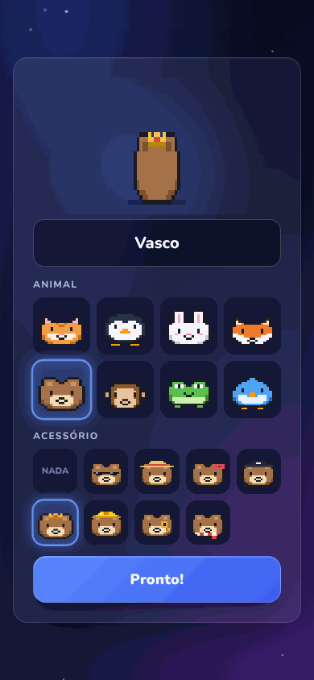
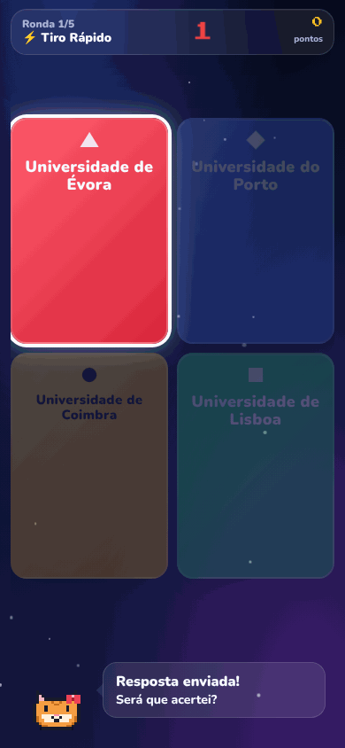
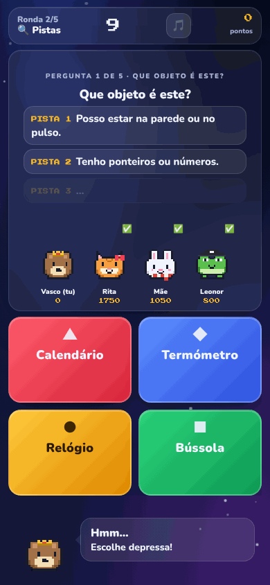
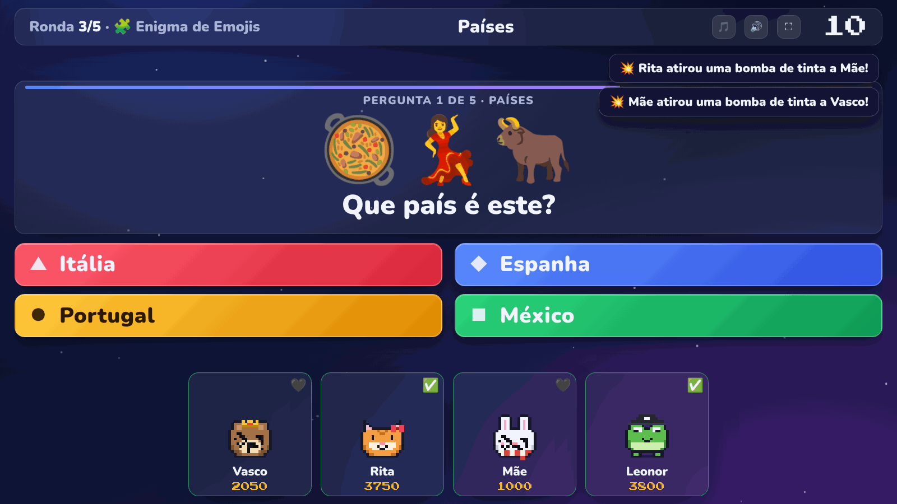
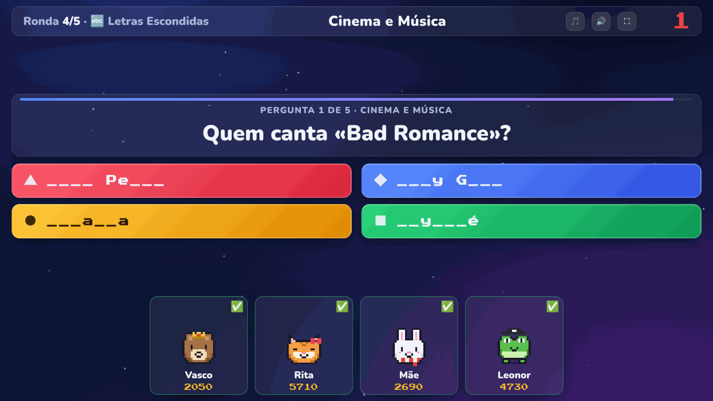
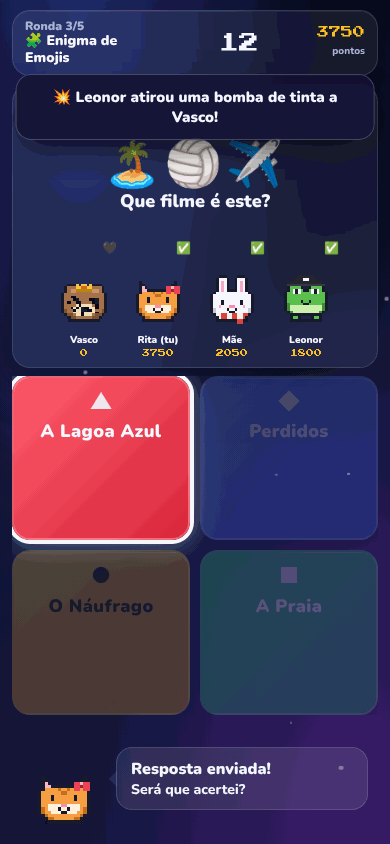
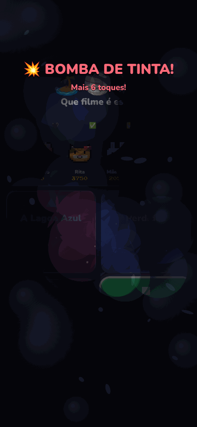
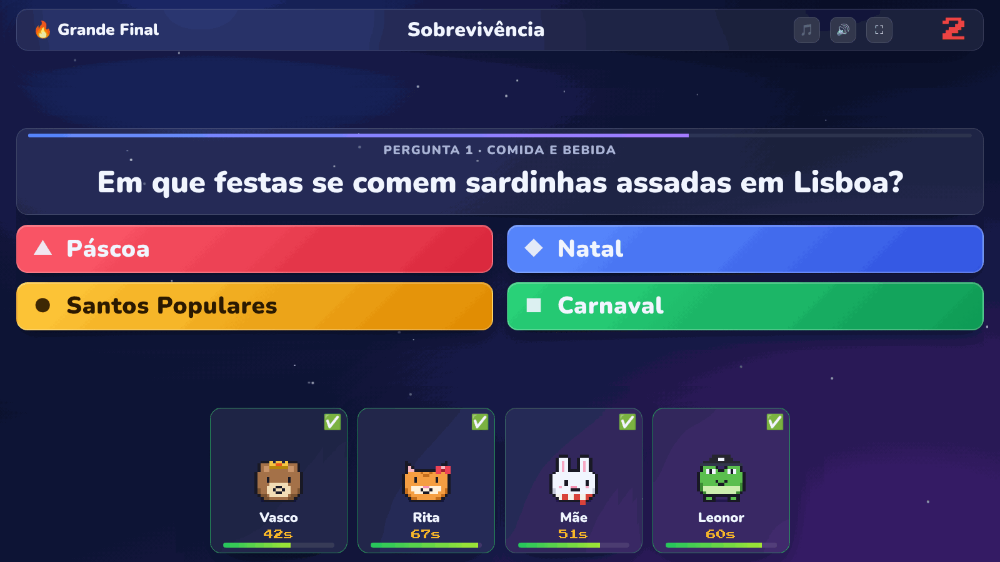
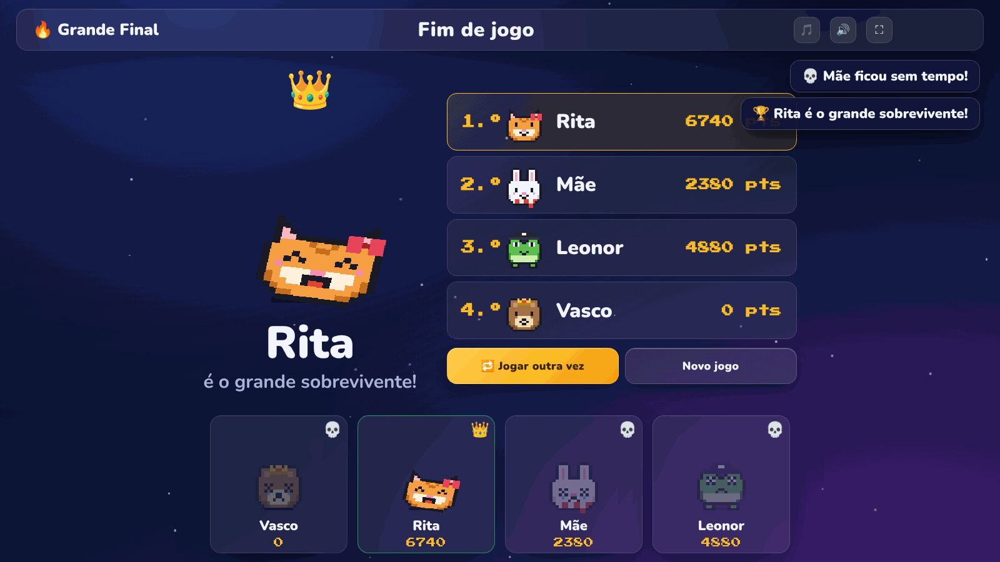

# 🎮 Saber & Sobreviver · Know & Survive

🇵🇹 Português · 🇬🇧 [English below](#-english)

**Um quiz multijogador para jogar em família ou com amigos, no estilo *Buzz!*.**
Até 6 jogadores, cada um com o seu telemóvel como comando. Não é preciso instalar nada: basta abrir um link no browser.

## ▶️ [JOGAR AGORA](https://bolinhared.github.io/saber-e-sobreviver/)

Abre este link no PC (ligado à TV) ou no telemóvel e escolhe **Criar jogo**. Os outros jogadores abrem o mesmo link e carregam em **Entrar num jogo**.

## 🕹️ Como jogar

### 📺 Modo TV (em casa)
1. No PC ligado à TV, abre o link do jogo e carrega em **Criar jogo → Modo TV**.
2. Cada jogador lê o **código QR** do ecrã com o telemóvel (ou abre o link e escreve o **código de 4 letras**).
3. Cada um cria o seu boneco e o anfitrião carrega em **Começar**.

### 🍽️ Modo Mesa (só telemóveis)
Ideal para um restaurante ou uma viagem. Um telemóvel cria a sala com **Criar jogo → Modo Mesa**, também joga, e partilha o link com os outros.
Neste modo, **todos veem tudo no próprio telemóvel**: a pergunta, os bonecos e as pontuações.

> Todos os aparelhos precisam de internet. Os jogadores podem até estar em casas diferentes.

## 🐻 Bonecos tamagotchi

Cada jogador escolhe um animal em pixel art (gato, pinguim, coelho, raposa, urso, macaco, sapo ou pássaro) e um acessório (óculos de sol, chapéu de palha, laço, chapéu pirata, coroa, capacete, monóculo ou cachecol).

Os bonecos reagem a tudo: saltam e dão cambalhotas quando acertam, choram quando erram, entram em pânico quando o tempo está a acabar e ficam cobertos de tinta ou de creme quando são atacados. Toca no teu boneco para ele fazer uma acrobacia!

## 🏆 Como funciona uma partida

Cada jogo tem **5 rondas**, cada uma com um estilo diferente, e termina sempre com a **Grande Final**.

| Duração | Perguntas por ronda |
|---|---|
| Rápido | 3 |
| Médio | 5 |
| Longo | 7 |

Em cada ronda:
1. **Votação:** os jogadores escolhem um de três temas.
2. **Sabotagem:** cada um pode atacar um adversário.
3. **Perguntas:** respondem no telemóvel. Quanto mais rápido, melhor!

### Os 7 estilos de ronda

| | Estilo | Como funciona |
|---|---|---|
| ⚡ | **Tiro Rápido** | Todos os que acertam ganham pontos, por ordem de chegada (1000, 800, 650…) |
| 🎯 | **Tiro Certeiro** | Só o primeiro a acertar ganha 1000. Quem erra perde 250! |
| 🔤 | **Letras Escondidas** | As respostas aparecem sem letras, que vão surgindo enquanto os pontos descem |
| 🧩 | **Enigma de Emojis** | Adivinha o filme, a expressão ou o país escrito em emojis |
| 🔍 | **Pistas** | As pistas aparecem uma a uma: responde cedo para ganhar mais |
| 🎰 | **Tudo ou Nada** | Aposta antes de ver a pergunta. Acertas e ganhas, erras e perdes! |
| ✅ | **Verdadeiro ou Falso** | Afirmações relâmpago com 6 segundos cada |

### 😈 Sabotagem

| Arma | Efeito |
|---|---|
| 💣 **Bomba de tinta** | O ecrã da vítima fica preto. Tem de tocar 10 vezes para limpar |
| 🥧 **Tarte na cara** | O ecrã fica coberto de creme. Tem de passar o dedo para limpar |
| 💰 **Ladrão de pontos** | Rouba 250 pontos na hora |

A tinta e a tarte caem numa pergunta surpresa da ronda!

### 🔥 A Grande Final (Sobrevivência)

Os pontos transformam-se em **tempo**: o líder começa com 70 segundos e o último com 45. Assim, toda a gente ainda pode ganhar.

O relógio desce para todos ao mesmo tempo e as perguntas aparecem sem parar:
- Não responder tira 5 segundos.
- Errar tira 10 segundos.
- Quem chega a zero é eliminado.

**O último a sobreviver ganha!**

## 🌍 Idiomas

O jogo está em **português** e em **inglês**. Escolhe o idioma no ecrã inicial ou na sala de espera: os telemóveis de todos os jogadores mudam ao mesmo tempo. Também podes abrir o link já em inglês: [bolinhared.github.io/saber-e-sobreviver/?lang=en](https://bolinhared.github.io/saber-e-sobreviver/?lang=en)

## 📚 Perguntas

Há mais de **1000 perguntas em cada idioma**. Em inglês, o tema *Portugal* dá lugar a **World Culture** (moedas, línguas, festas e monumentos do mundo inteiro).

Em português, os públicos são:

- **Geral (adultos):** História, Geografia, Ciência, Desporto, Artes e Letras, Portugal, Natureza, Cinema e Música, Comida e Bebida.
- **Crianças (até 12 anos):** Escola, Animais, Desenhos e Filmes, Corpo Humano, Planeta Terra, Desporto e Jogos, Comida. Têm mais tempo para responder.
- **Família:** mistura os dois.

O jogo lembra-se das perguntas que já saíram, para não se repetirem de um jogo para o outro. Para isso funcionar, usa sempre o mesmo aparelho para criar a sala.

## 🎵 Som

Tem música de fundo e efeitos sonoros no ecrã principal. Os botões 🎵 e 🔊 desligam cada um deles.

## 🛠️ Detalhes técnicos

- **Um único ficheiro:** `index.html`, com HTML, CSS e JavaScript.
- **Sem servidor próprio:** os aparelhos ligam-se diretamente uns aos outros com [PeerJS](https://peerjs.com/) (WebRTC).
- **Gráficos e sons:** os bonecos são desenhados em código e a música é gerada no momento. Não há imagens nem ficheiros de áudio.
- **Ligações:** se um telemóvel perder a ligação, basta voltar a abrir o link para regressar ao jogo.
- **Teste num só PC:** abre o link com `?local=1` no fim e usa várias abas, uma como TV e as outras como telemóveis.

---

## 🇬🇧 English

**A multiplayer party quiz in the style of *Buzz!*, for family and friends.** Up to 6 players, each using their phone as a controller. Nothing to install: just open a link in the browser.

### ▶️ [PLAY NOW](https://bolinhared.github.io/saber-e-sobreviver/?lang=en)

- **TV Mode:** open the link on a PC connected to the TV and tap **Create game → TV Mode**. Players scan the QR code or type the 4-letter code on their phones.
- **Table Mode:** phones only. One phone creates the room, plays too, and shares the link. Everyone sees everything on their own screen.
- **Pixel-art tamagotchi avatars:** 8 animals and 9 accessories. They jump, spin, cry and panic during the game.
- **5 rounds plus a Grand Final.** Round styles: Quick Fire, Sharpshooter, Hidden Letters, Emoji Riddle, Clues, All or Nothing, and True or False.
- **Sabotage before each round:** Ink bomb (tap to clean), Pie in the face (swipe to wipe), or Point thief (steal 250 points).
- **Grand Final (Survival):** your points become time, between 45 and 70 seconds, so even the last player can still win. No answer costs 5 s and a wrong answer costs 10 s. The last one standing wins!
- **Over 1000 questions in English,** with worldwide topics: History, Geography, Science, Sport, Arts & Literature, World Culture, Nature, Film & Music, Food & Drink. There is also a **Kids (up to 12)** set and a **Family** mix. Questions don't repeat from one game to the next.
- **Languages:** switch between Português and English on the home screen or in the lobby.
